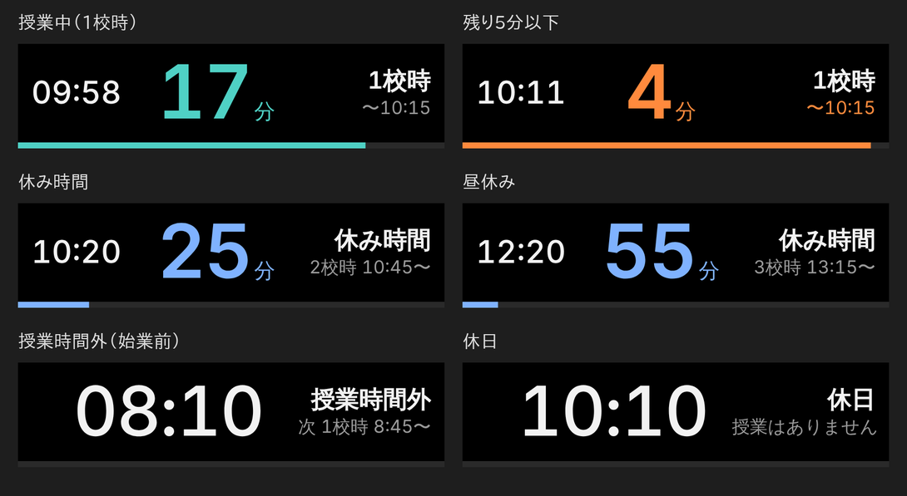
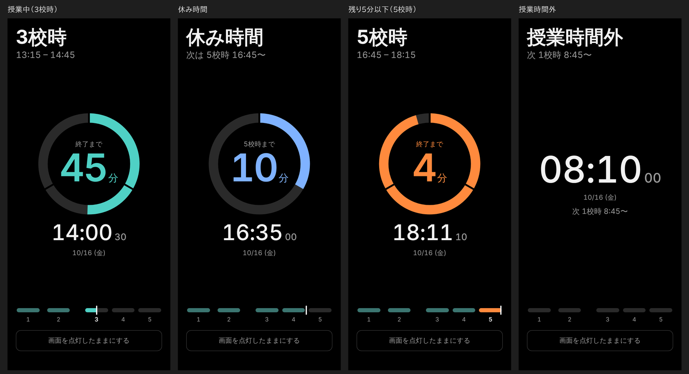

# ClassClock

授業中に、**現在時刻と授業終了までの残り時間**をひと目で確認するための時計アプリです。
HTML / CSS / JavaScript だけの静的 Web アプリ（ビルド不要・外部ライブラリなし）です。

- **Mac**: Hammerspoon で小窓（約 285×70 px）を常時最前面に表示（`?mode=compact`）
- **スマホ**: 縦画面向け。進捗リング・残り時間・秒つきデジタル時計・画面スリープ防止ボタン
- 東北学院大学 2026 年度の標準授業時間帯で校時を自動判定（日本時間基準）

## 公開ページ

- スマホ・ブラウザ用: <https://sasekazu.github.io/class-clock/>
- Mac の小窓（コンパクト表示）用: <https://sasekazu.github.io/class-clock/?mode=compact>

## 表示例

画面サイズ・時刻を指定して描画した例です（`?now=` で時刻を固定。実機の画面写真ではありません）。

**Mac（コンパクト表示 `?mode=compact`、285×70 px）**



**スマホ（縦画面）**



## 表示の見かた

| 状態 | 中央の大きな数字 | 色 |
|---|---|---|
| 授業中 | 終了までの残り**分**（端数は切り上げ） | 水色 |
| 授業中（残り 5 分以下） | 同上 | オレンジ |
| 休み時間 | 次の授業開始までの**分** | 青 |
| 授業時間外（始業前・終業後・土日祝） | 現在時刻 | 白 |

Mac のコンパクト表示では秒は表示しません（スマホ表示のデジタル時計には小さく秒を表示します）。点滅・音はありません。

### 校時（2026 年度 標準）

| 校時 | 開始 | 終了 |
|---|---|---|
| 1 | 8:45 | 10:15 |
| 2 | 10:45 | 12:15 |
| 3 | 13:15 | 14:45 |
| 4 | 15:00 | 16:30 |
| 5 | 16:45 | 18:15 |
| 6 | 18:25 | 19:55 |
| 7 | 20:05 | 21:35 |

- 土日・祝日（振替休日・国民の休日を含む。内蔵ロジックで計算）は授業時間外として扱います。
- 特別日程・臨時休講・補講日などは判定しません（初期版の仕様）。
- 時間帯を変えるときは `js/schedule.js` の `PERIODS` を編集します。

## 起動方法

ビルドは不要です。

```sh
# 一番簡単: index.html をブラウザで開く
open index.html            # macOS

# もしくはローカルサーバー（画面スリープ防止は HTTPS か localhost でのみ動作します）
python3 -m http.server 8000
# → http://localhost:8000/
```

### 表示モード（URL パラメータ）

| URL | 表示 |
|---|---|
| `index.html` | 画面サイズで自動判定（高さ 160px 以下、または横長 3.2:1 以上ならコンパクト、それ以外はスマホ表示） |
| `index.html?mode=compact` | コンパクト表示（Mac の小窓向け） |
| `index.html?mode=mobile` | スマホ表示 |

レイアウトの確認用に、時刻を指定するデバッグ用パラメータがあります。

- `?now=2026-10-16T10:11:10` … その時刻（日本時間）から時計を進める（`+09:00` などのオフセット付きも可）
- `?now=2026-10-16T10:11:10&freeze=1` … その時刻で止める

例: `index.html?mode=compact&now=2026-10-16T10:11:10&freeze=1`（残り 5 分以下の表示）

## スマホ表示

- 上部: 校時と授業時間帯
- 中央: **進捗リング**（経過割合を 12 時の位置から時計回りに塗り、中央に残り時間を表示。**30 分ごとに区切り**が入るので、90 分の授業は 3 等分、60 分の昼休みは 2 等分で見えます）と、その下に小さな秒つきのデジタル時計
- 下部: **1 日の進み具合**（1〜5 校時を時間に比例して並べたバー（6・7 校時はバーには出しません。表示するコマ数は `js/app.js` の `DAY_BAR_LAST_PERIOD`）。いまの校時を塗りつぶし、現在位置を白い線で示します。終わった校時は薄く塗られます）と、画面点灯ボタン
- 授業時間外は、リングを出さずに現在時刻を大きく表示します（1 日のバーは下部に残ります）
- **画面を点灯したままにする** ボタン: [Screen Wake Lock API](https://developer.mozilla.org/docs/Web/API/Screen_Wake_Lock_API) で画面スリープを防ぎます。
  - HTTPS（公開ページ）または localhost で開いたときに使えます。
  - 非対応のブラウザや `http://` で開いた場合は、ボタンが無効になり「端末の自動ロック設定を長くしてください」と案内します。
  - 別のアプリやタブに切り替えると解除されます。ページに戻ると、ボタンを ON にしていた場合は自動で再取得します。
  - 省電力モードなどで拒否されることがあります。その場合はメッセージを表示します。

ホーム画面に追加（iOS: 共有 → ホーム画面に追加）すると、アドレスバーなしで使えます。

## Hammerspoon の設定（Mac）

[Hammerspoon](https://www.hammerspoon.org/) で、compact 表示を枠なし・常時最前面の小窓として出します。

### 機能

| 操作 | 内容 |
|---|---|
| `⌃⌥⌘ C` | 表示 / 非表示の切り替え |
| `⌃⌥⌘ M` | 画面の四隅を順番に移動（右上 → 右下 → 左下 → 左上） |
| `⌃⌥⌘ R` | ページを再読み込み |
| `⌥`（Option）を押しながらドラッグ | 好きな位置へ移動 |

- 位置と表示 / 非表示は `hs.settings` に保存され、Hammerspoon の再起動・Mac の再起動後も復元されます。接続していたディスプレイが外れていた場合は、隅の初期位置に戻ります。
- 読み込みに失敗したとき（ログイン直後で Wi-Fi が未接続など）は、30 秒ごとに自動で再試行します。
- 設定は `hammerspoon/init.lua` 先頭の `config` で変更できます（URL・サイズ・初期の隅・ショートカット・ウィンドウレベルなど）。

### 導入手順

1. Hammerspoon をインストールして起動し、System Settings → Privacy & Security → **Accessibility** で許可します（Option+ドラッグの検出に必要です）。
2. 設定ファイルを置きます。
   - 他に Hammerspoon の設定がない場合:
     ```sh
     mkdir -p ~/.hammerspoon
     cp hammerspoon/init.lua ~/.hammerspoon/init.lua
     ```
   - すでに `~/.hammerspoon/init.lua` がある場合:
     ```sh
     cp hammerspoon/init.lua ~/.hammerspoon/classclock.lua
     echo 'require("classclock")' >> ~/.hammerspoon/init.lua
     ```
3. メニューバーの Hammerspoon アイコン → **Reload Config**。右上に小窓が現れます。
4. 自動で起動したい場合は、Hammerspoon の Preferences で **Launch Hammerspoon at login** をオンにします。

オフラインでも使いたい場合は、リポジトリのフォルダで `python3 -m http.server 8000` を動かし、`config.url` を `http://localhost:8000/?mode=compact` にします。

### フルスクリーンのプレゼン中に表示するための設定と動作確認

macOS では、フルスクリーンアプリ（独立した Space）の上にほかのアプリのウィンドウを出すには制約があります。`init.lua` では次の設定をしています。

- ウィンドウの挙動に `canJoinAllSpaces` と `fullScreenAuxiliary` を指定（`hs.webview:behavior`）
- ウィンドウレベルを高く設定（既定 `assistiveTechHigh`。`hs.webview:level`）
- `hs.dockicon.hide()` で Hammerspoon の Dock アイコンを隠す（Dock に出ているアプリのウィンドウはフルスクリーン Space の上に出にくいため。メニューバーのアイコンは残ります）
- ウィンドウをフォーカスを奪わない形式（`nonactivating`）にし、プレゼンソフトの操作を邪魔しない

> **注意**: これらは Hammerspoon の API 仕様に基づく設定ですが、Keynote / PowerPoint のスライドショー中に実際に前面に出るかは、アプリと macOS のバージョンに依存し、開発環境（macOS 以外）では実機確認できていません。必ず次の手順で確認してください。

**確認手順（段階的に）**

1. **通常のウィンドウの上**: 設定を再読み込みして、小窓が右上に出て、ほかのアプリを前面にしても残ることを確認。
2. **ほかのアプリのフルスクリーン**: Safari や TextEdit のウィンドウ左上の緑ボタンでフルスクリーンにして、小窓が上に表示されることを確認（Space を切り替えても付いてくること）。
3. **Keynote**: 適当なスライドを作り、「再生」でスライドショーを開始して、小窓が表示されることを確認。
4. **PowerPoint**: 「スライドショー」を開始して、同様に確認。
5. 外部ディスプレイ / プロジェクターで発表する場合は、**発表者用ディスプレイ**（手元の画面）に小窓があるかも確認。

**表示されないとき**

- `config.level` を `"screenSaver"` ⇄ `"assistiveTechHigh"` で切り替えて、Reload Config して試す。
- Dock に Hammerspoon のアイコンが出ていないことを確認（出ている場合は Hammerspoon の Preferences で **Show Dock icon** をオフにして再起動）。
- 複数ディスプレイの場合、System Settings → Desktop & Dock の **Displays have separate Spaces**（ディスプレイごとに個別の操作スペース）の設定を切り替えて試す。
- Keynote の「ウィンドウ内でスライドショーを再生」など、フルスクリーンではなくウィンドウで再生するモードを使う（通常のウィンドウの上には、フルスクリーンの制約なく表示できます）。
- Hammerspoon Console（メニューバーのアイコン → Console）にエラーが出ていないか確認。

## テスト

校時の境界・休み時間・日付変更・祝日などのロジックを Node.js（標準の `node:test`、追加パッケージなし）でテストします。

```sh
node --test
```

ホストのタイムゾーンに依存しないことは、たとえば `TZ=America/Los_Angeles node --test` でも確認できます。

## 見た目の調整

`css/style.css` の先頭にある次のブロックを編集します。

- **palette**: 背景・文字・授業中 / 警告 / 休み時間などの色
- **sizes: compact** (`--c-*`): 余白、時刻・残り時間・校時のフォントサイズ、プログレスバーの太さ（285×70 のキャンバスを基準にした数値で、ウィンドウサイズに合わせて拡大縮小されます）
- **sizes: mobile** (`--m-*`): スマホ表示の各サイズ

警告色に切り替わる残り時間は `js/schedule.js` の `WARN_MINUTES`（既定 5 分）です。

## ファイル構成

```
index.html            画面（compact / mobile の両方のマークアップ）
css/style.css         スタイル（色・サイズは先頭の変数で調整）
js/schedule.js        校時判定・残り時間・祝日のロジック（DOM に依存しない。Mac / スマホ共通、テスト対象）
js/layout.js          compact / mobile の切り替え
js/app.js             描画（進捗リング・1 日のバー含む）・Wake Lock
tests/schedule.test.js  ロジックのテスト
hammerspoon/init.lua  Hammerspoon の設定
```

既存の [saselab-clock](https://github.com/sasekazu/saselab-clock) の日本時間の扱い・祝日計算を参考にした、独立したプロジェクトです。
